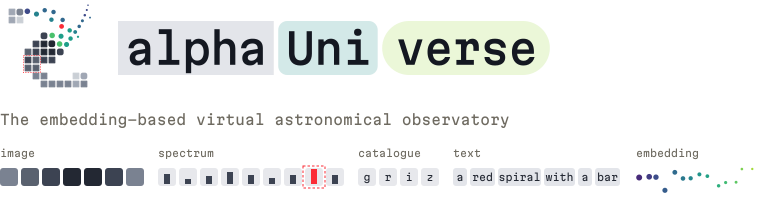

# alphaUniverse

<picture>
  <source media="(prefers-color-scheme: dark)" srcset="docs/_static/alphauniverse-header-dark.svg" />
  
</picture>

`alphauniverse` is a Python library for searching galaxies of the [COSMOS](https://en.wikipedia.org/wiki/COSMOS_field) field through [AION](https://arxiv.org/abs/2510.17960), [Polymathic](https://polymathic-ai.org/)'s foundation model for astronomy.

- **Similarity search**: pick image regions, wavelengths and catalog values of a galaxy in any of its surveys, or whole surveys, and rank every galaxy by predictive query likelihood over AION's predictions.
- **Text search**: search galaxies in natural language.
- **Predictions**: read what AION expects a galaxy's image, spectrum and catalog values to be, including in surveys that never observed it.

```python
import alphauniverse

found = alphauniverse.search_by_text("a spiral galaxy with a bright bar")
```

See the [library docs](docs/library/index.rst) for installing it and the data it reads.

## Web

The [**website**](https://alphauniverse.aiforscientists.org) is a GUI for alphaUniverse with a [Legacy Survey](https://www.legacysurvey.org/viewer)-style sky view, parametric UMAP of AION embeddings, and data exports.

Run the website locally with [uv](https://docs.astral.sh/uv/) and [bun](https://bun.sh):

```sh
uv run python -m scripts.dev_subset                      # generate a small subset for dev
ACCESS_PASSWORD=local uv run fastapi dev server/main.py  # start the server with password "local"
cd web && bun install && bun run dev                     # start the web app
```
