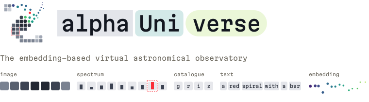

# alphaUniverse

<picture>
  <source media="(prefers-color-scheme: dark)" srcset="docs/_static/alphauniverse-header-dark.svg" />
  
</picture>

[**alphaUniverse**](https://alphauniverse.aiforscientists.org) wraps [AION](https://arxiv.org/abs/2510.17960), [Polymathic](https://polymathic-ai.org/)'s foundation model for astronomy, in a web interface over [COSMOS](https://en.wikipedia.org/wiki/COSMOS_field).

## Features

- **Map**: every galaxy placed by its neighbours under whole-mode search, at any position or the same place; coloured by redshift, stellar mass, star formation rate, specific star formation rate or g − r colour, measured or predicted, and filtered to a range of it.
- **Galaxy view**: crossmatches, and Legacy Survey and HSC images and DESI and SDSS spectra in groups that collapse.
- **AION predictions**: shows what AION predicts for any galaxy in every survey, observed or not.
- **Similarity search**: pick image regions, wavelengths, and catalogue values of a galaxy in any of its surveys, and search with predictive query likelihood over AION's predictions.
- **Text search**: search galaxies using natural language.
- **Export**: Export any search results through CSV or [ECSV](https://docs.astropy.org/en/stable/io/ascii/ecsv.html).

## Running locally

Requires [uv](https://docs.astral.sh/uv/) and [bun](https://bun.sh).

```sh
uv run python -m scripts.fixture                       # synthetic artifacts in .cache/fixture
ALPHAUNIVERSE_CACHE=.cache/fixture uv run fastapi dev  # API on 127.0.0.1:8000
cd frontend && bun install && bun run dev              # frontend
```
