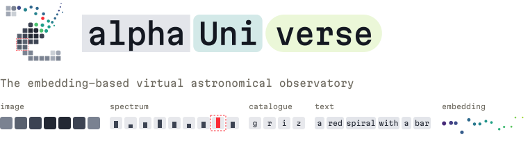

# alphaUniverse

<picture>
  <source media="(prefers-color-scheme: dark)" srcset="docs/_static/alphauniverse-header-dark.svg" />
  
</picture>

[**alphaUniverse**](https://alphauniverse.aiforscientists.org) wraps [AION](https://arxiv.org/abs/2510.17960), [Polymathic](https://polymathic-ai.org/)'s foundation model for astronomy, in a web interface over [COSMOS](https://en.wikipedia.org/wiki/COSMOS_field).

## Features

- **Sky**: find galaxies through a [Legacy Survey](https://www.legacysurvey.org/viewer)-style interface.
- **Parametric UMAP**: select galaxies with similar features through AION embeddings projected using a parametric UMAP.
- **Text search**: search galaxies using natural language.
- **Similarity search**: pick image regions, wavelengths, and catalogue values of a galaxy in any of its surveys and search with predictive query likelihood over AION predictions.
- **Export**: export search results through CSV or [ECSV](https://docs.astropy.org/en/stable/io/ascii/ecsv.html).

## Running

Requires [uv](https://docs.astral.sh/uv/) and [bun](https://bun.sh).

```sh
uv run python -m scripts.dev_subset       # generate a small subset for dev
ACCESS_PASSWORD=local uv run fastapi dev  # start the server with password "local"
cd web && bun install && bun run dev      # start the web app
```
